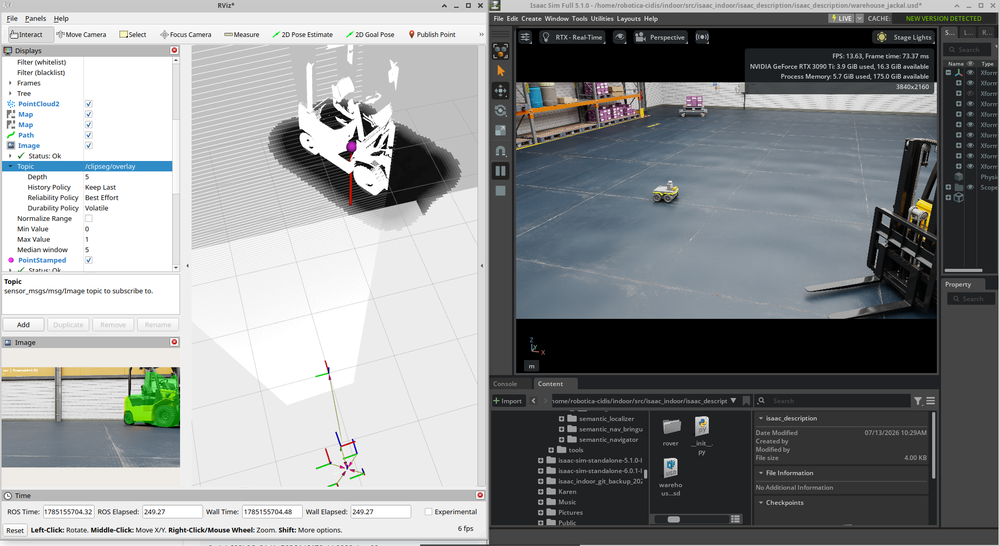
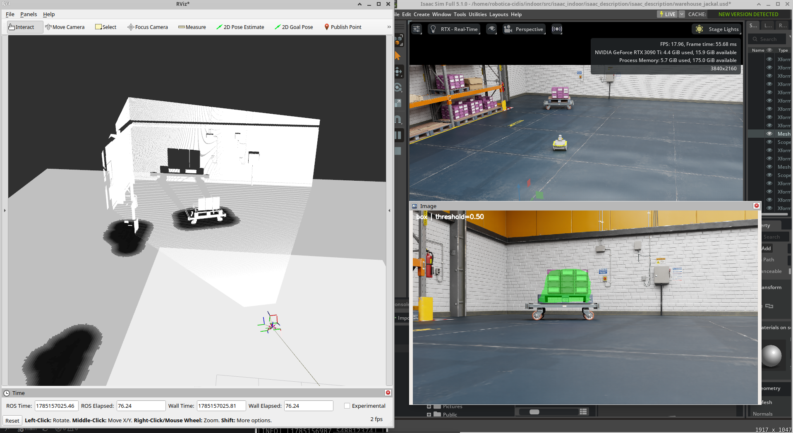
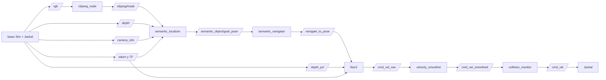
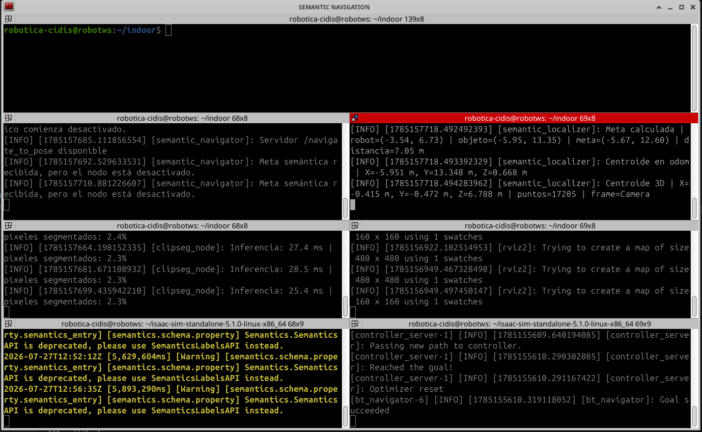
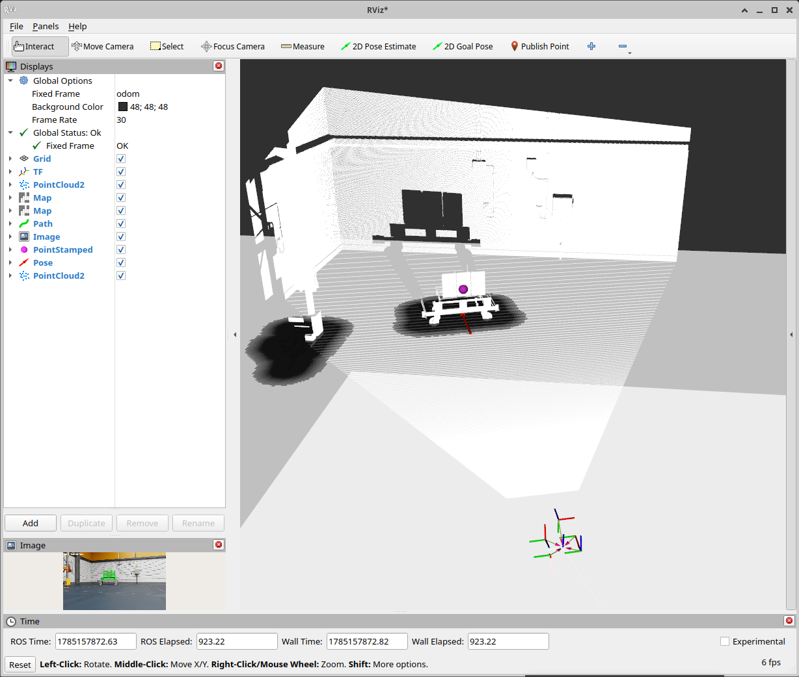
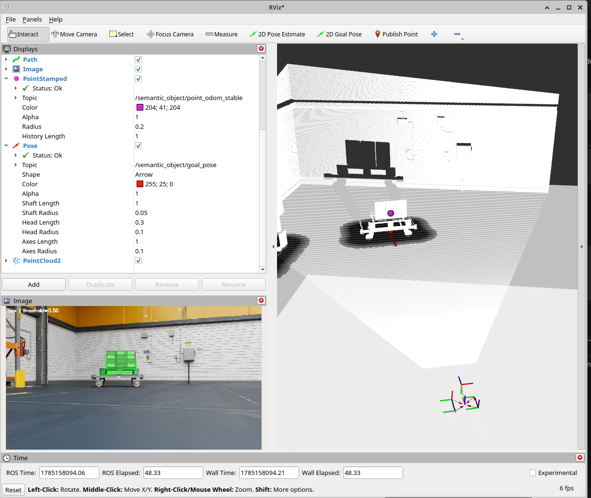
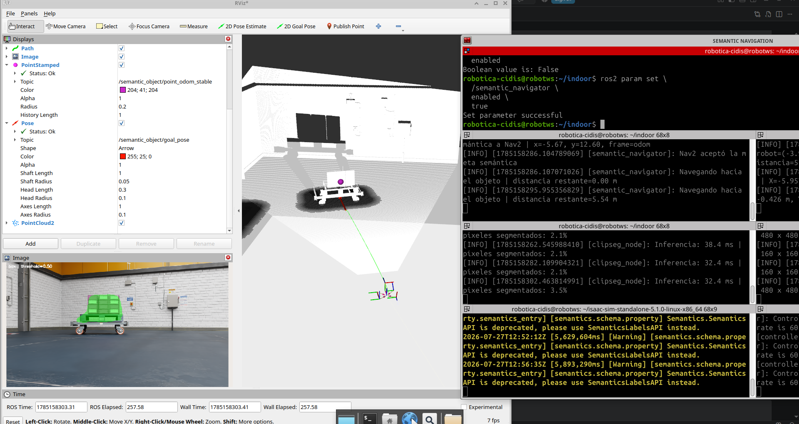

# Navegación semántica en Isaac Sim con ROS 2

Sistema de navegación semántica para un robot Clearpath Jackal simulado
en NVIDIA Isaac Sim. El sistema permite localizar un objeto mediante una
descripción textual, estimar su posición tridimensional y navegar
autónomamente hasta una posición segura frente a él.



El pipeline integra:

- NVIDIA Isaac Sim 5.1.0.
- ROS 2 Jazzy.
- CLIPSeg.
- Imágenes RGB y de profundidad.
- Transformaciones TF.
- Nav2.
- MPPI Controller.
- Rotation Shim Controller.
- Clearpath Jackal.

## Descripción general

El usuario proporciona una clase textual, por ejemplo:

```text
box
```



CLIPSeg segmenta las regiones de la imagen RGB que corresponden con esa
descripción. La máscara se combina con la imagen de profundidad y los
parámetros intrínsecos de la cámara para calcular la posición 3D del
objeto.

Posteriormente, el punto se transforma desde el frame de la cámara hasta
el frame `odom`. A partir de esta posición se genera una meta situada
antes del objeto y orientada hacia él.

Finalmente, la meta se envía al stack Nav2 mediante la acción
`NavigateToPose`.

## Proyecto base

Este trabajo está basado en
[`jumasaet/isaac_indoor`](https://github.com/jumasaet/isaac_indoor),
utilizando como referencia el commit:

```text
8adabf68b8fe01d1a563f4df478ebb8033cbaa66
```

## Arquitectura



## Paquetes principales

### `clipseg_ros`

Nodo encargado de ejecutar CLIPSeg sobre las imágenes publicadas por
Isaac Sim.

Entradas:

| Tópico | Tipo | Descripción |
|---|---|---|
| `/rgb` | `sensor_msgs/msg/Image` | Imagen RGB de la cámara |

Salidas:

| Tópico | Tipo | Descripción |
|---|---|---|
| `/clipseg/mask` | `sensor_msgs/msg/Image` | Máscara binaria |
| `/clipseg/probability` | `sensor_msgs/msg/Image` | Probabilidad estimada |
| `/clipseg/overlay` | `sensor_msgs/msg/Image` | Visualización superpuesta |

Parámetros principales:

| Parámetro | Ejemplo | Descripción |
|---|---:|---|
| `input_topic` | `/rgb` | Imagen de entrada |
| `prompt` | `box` | Objeto buscado |
| `threshold` | `0.50` | Umbral de segmentación |
| `max_rate_hz` | `2.0` | Frecuencia máxima de inferencia |
| `use_sim_time` | `true` | Uso del reloj simulado |

### `semantic_localizer`

Combina la máscara de CLIPSeg con profundidad y parámetros de cámara.

Entradas:

| Tópico | Descripción |
|---|---|
| `/clipseg/mask` | Máscara semántica |
| `/depth` | Imagen de profundidad |
| `/camera_info` | Parámetros intrínsecos |
| `/tf` y `/tf_static` | Transformaciones de coordenadas |

Salidas:

| Tópico | Descripción |
|---|---|
| `/semantic_object/point_camera` | Punto 3D en la cámara |
| `/semantic_object/point_odom` | Punto transformado a `odom` |
| `/semantic_object/point_odom_stable` | Punto estabilizado |
| `/semantic_object/goal_pose` | Meta de navegación |

La proyección utiliza el modelo pinhole:

```text
X = (u - cx) · Z / fx
Y = (v - cy) · Z / fy
Z = profundidad
```

donde:

- `u`, `v`: coordenadas del píxel.
- `fx`, `fy`: distancias focales.
- `cx`, `cy`: centro óptico.
- `Z`: profundidad medida.

### `semantic_navigator`

Recibe la meta publicada por `semantic_localizer` y la envía a Nav2
mediante la acción:

```text
/navigate_to_pose
```

Por seguridad, el nodo puede iniciarse con:

```text
enabled = false
```

Esto permite comprobar visualmente la meta antes de autorizar el
movimiento.

### `semantic_nav_bringup`

Contiene:

- Configuración de Nav2.
- Configuración del controlador.
- Costmaps local y global.
- Velocity Smoother.
- Collision Monitor.
- Archivo de lanzamiento de navegación.
## Estructura del repositorio

```text
isaac-semantic-navigation/
├── README.md
├── BASE_PROJECT.md
├── .gitignore
├── assets/
├── tools/
│   └── nav_velocity_monitor.py
└── src/
    ├── isaac_indoor/
    │   ├── isaac_description/
    │   └── isaac_rover/
    ├── clipseg_ros/
    ├── semantic_localizer/
    ├── semantic_navigator/
    └── semantic_nav_bringup/
```

## Entorno utilizado

| Componente | Versión o configuración |
|---|---|
| Sistema operativo | Ubuntu 24.04 |
| ROS 2 | Jazzy |
| NVIDIA Isaac Sim | 5.1.0 |
| Middleware | Fast DDS |
| `ROS_DOMAIN_ID` | `0` |
| Python de ROS | Python 3.12 |
| Robot | Clearpath Jackal |
| Controlador | MPPI + Rotation Shim |

## Requisitos

Instalar ROS 2 Jazzy y los paquetes de navegación:

```bash
sudo apt update

sudo apt install \
  ros-jazzy-navigation2 \
  ros-jazzy-nav2-bringup \
  ros-jazzy-rviz2 \
  ros-jazzy-tf2-tools \
  ros-jazzy-rqt-image-view
```

También se requiere:

- NVIDIA Isaac Sim 5.1.0.
- GPU NVIDIA compatible.
- Drivers NVIDIA funcionales.
- Isaac ROS 2 Bridge habilitado.
- Git.
- Python 3.12.

## Instalación

Clonar el repositorio:

```bash
git clone \
  https://github.com/juanfranciscosm/isaac-semantic-navigation.git

cd isaac-semantic-navigation
```

Crear el entorno de CLIPSeg:

```bash
python3 -m venv \
  --system-site-packages \
  .venv

source .venv/bin/activate

python -m pip install --upgrade pip
python -m pip install "setuptools<80"
python -m pip install \
  -r src/clipseg_ros/requirements.txt
```

Compilar el workspace:

```bash
deactivate 2>/dev/null || true

source /opt/ros/jazzy/setup.bash

colcon build --symlink-install

source install/setup.bash
```

## Configuración de ROS 2

Todas las terminales deben utilizar:

```bash
export ROS_DOMAIN_ID=0
export RMW_IMPLEMENTATION=rmw_fastrtps_cpp
```

El dominio configurado en los Action Graphs de Isaac Sim también debe ser
`0`.

Una diferencia en el Domain ID provoca que los tópicos sean visibles
solo dentro de una parte del sistema.

## Ejecución

El sistema se ejecuta en varias terminales.



### Terminal 1: iniciar Isaac Sim

Se asume que NVIDIA Isaac Sim 5.1.0 ya está instalado en:

```text
~/isaac-sim-standalone-5.1.0-linux-x86_64
```

Ingresar al directorio de instalación:

```bash
cd ~/isaac-sim-standalone-5.1.0-linux-x86_64
```

Salir de cualquier entorno Conda activo:

```bash
conda deactivate 2>/dev/null || true
```

Limpiar variables heredadas de otros workspaces o entornos ROS 2:

```bash
unset AMENT_PREFIX_PATH
unset COLCON_PREFIX_PATH
unset CMAKE_PREFIX_PATH
unset PYTHONPATH
```

Configurar Isaac Sim y ROS 2 Jazzy:

```bash
export isaac_sim_package_path="$PWD"
export ROS_DISTRO=jazzy
export RMW_IMPLEMENTATION=rmw_fastrtps_cpp
export ROS_DOMAIN_ID=0
```

Añadir las bibliotecas de ROS 2 Jazzy incluidas con el ROS 2 Bridge de
Isaac Sim:

```bash
export LD_LIBRARY_PATH="${LD_LIBRARY_PATH:+$LD_LIBRARY_PATH:}$isaac_sim_package_path/exts/isaacsim.ros2.bridge/jazzy/lib"
```

Iniciar Isaac Sim:

```bash
./isaac-sim.sh \
  --/rtx/verifyDriverVersion/enabled=false \
  --/renderer/multiGpu/enabled=false \
  --/renderer/multiGpu/autoEnable=false \
  --/renderer/activeGpu=1 \
  --/isaac/startup/ros_bridge_extension=isaacsim.ros2.bridge
```

#### Explicación de la configuración

- `unset AMENT_PREFIX_PATH`, `COLCON_PREFIX_PATH`, `CMAKE_PREFIX_PATH` y
  `PYTHONPATH` evita que Isaac Sim herede rutas de ROS 2, Conda o del
  workspace `~/indoor` que puedan interferir con sus bibliotecas
  internas.
- `ROS_DISTRO=jazzy` indica al ROS 2 Bridge qué distribución debe cargar.
- `RMW_IMPLEMENTATION=rmw_fastrtps_cpp` selecciona Fast DDS.
- `ROS_DOMAIN_ID=0` permite que Isaac Sim y los nodos del workspace se
  comuniquen dentro del mismo dominio.
- `LD_LIBRARY_PATH` incluye las bibliotecas Jazzy proporcionadas por la
  extensión `isaacsim.ros2.bridge`.
- `verifyDriverVersion/enabled=false` desactiva la validación del driver
  utilizada por Isaac Sim durante el arranque.
- `multiGpu/enabled=false` y `multiGpu/autoEnable=false` deshabilitan el
  renderizado multi-GPU.
- `activeGpu=1` selecciona la GPU utilizada en el computador del
  laboratorio.
- `ros_bridge_extension=isaacsim.ros2.bridge` solicita la activación del
  ROS 2 Bridge durante el inicio.

> `activeGpu=1` es específico del equipo utilizado durante el desarrollo.
> En otro computador se debe consultar el índice correcto con:
>
> ```bash
> nvidia-smi \
>   --query-gpu=index,name,memory.total \
>   --format=csv
> ```

Una vez abierto Isaac Sim:

1. Abrir la escena:

   ```text
   ~/indoor/src/isaac_indoor/isaac_description/isaac_description/warehouse_jackal.usd
   ```

2. Verificar que los nodos `ROS2 Context` de los Action Graphs tengan:

   ```text
   Domain ID = 0
   ```

3. Presionar **Play**.
4. Mantener la simulación ejecutándose mientras se inician Nav2,
   CLIPSeg, el localizador y el navegador semántico.

### Terminal 2: Nav2

```bash
conda deactivate 2>/dev/null || true

cd ~/indoor

source /opt/ros/jazzy/setup.bash
source install/setup.bash

export ROS_DOMAIN_ID=0
export RMW_IMPLEMENTATION=rmw_fastrtps_cpp

ros2 launch semantic_nav_bringup navigation.launch.py \
  use_sim_time:=True \
  autostart:=True \
  use_composition:=False
```

Comprobar:

```bash
ros2 action list | grep navigate_to_pose
```

Debe aparecer:

```text
/navigate_to_pose
```

### Terminal 3: iniciar y configurar RViz

Abrir una terminal nueva y cargar el entorno ROS 2:

```bash
conda deactivate 2>/dev/null || true

cd ~/indoor

source /opt/ros/jazzy/setup.bash
source install/setup.bash

export ROS_DOMAIN_ID=0
export RMW_IMPLEMENTATION=rmw_fastrtps_cpp

rviz2
```

#### Configuración inicial



En el panel izquierdo de RViz, abrir:

```text
Global Options
```

Configurar:

```text
Fixed Frame: odom
```

El frame `odom` se utiliza porque la posición estable del objeto y la
meta de navegación se publican en ese sistema de coordenadas.

---

#### 1. Mostrar la nube de puntos de profundidad

Seleccionar:

```text
Add
→ By display type
→ PointCloud2
→ OK
```

Configurar:

```text
Topic: /depth_pcl
```

Este display permite visualizar los obstáculos que Nav2 incorpora en los
costmaps mediante la nube `/depth_pcl`.

---

#### 2. Mostrar el resultado visual de CLIPSeg

Seleccionar:

```text
Add
→ By display type
→ Image
→ OK
```

Configurar:

```text
Topic: /clipseg/overlay
```

En las opciones de QoS:

```text
Reliability Policy: Best Effort
Durability Policy: Volatile
History Policy: Keep Last
Depth: 5
```

Configurar también:

```text
Transport Hint: raw
```

El uso de `Best Effort` es necesario porque el nodo `clipseg_node`
publica las imágenes con ese perfil QoS. Si RViz utiliza `Reliable`, el
display puede permanecer en:

```text
NO IMAGE
```

aunque el tópico exista y esté publicando correctamente.

---

#### 3. Mostrar la posición estable del objeto

Seleccionar:

```text
Add
→ By display type
→ PointStamped
→ OK
```

Configurar:

```text
Topic: /semantic_object/point_odom_stable
```

Opciones visuales recomendadas:

```text
Style: Spheres
Radius: 0.10 o 0.15
```

Este punto representa la posición tridimensional estabilizada del objeto
detectado, expresada en el frame `odom`.

---

#### 4. Mostrar la meta de navegación semántica

Seleccionar:

```text
Add
→ By display type
→ Pose
→ OK
```

Configurar:

```text
Topic: /semantic_object/goal_pose
```

Configurar la representación:

```text
Shape: Arrow
```

Opciones visuales:

```text
Shaft Length: 0.60
Shaft Radius: 0.05
Head Length: 0.20
Head Radius: 0.10
```

La posición de la flecha indica dónde debe detenerse el robot. La
dirección de la flecha representa la orientación final, calculada para
que el Jackal quede mirando hacia el objeto.

---

#### 5. Mostrar el árbol de transformaciones

Seleccionar:

```text
Add
→ By display type
→ TF
→ OK
```

La cadena utilizada por el sistema debe permitir transformar puntos desde
la cámara hasta `odom`.

---

### Terminal 4: CLIPSeg

```bash
conda deactivate 2>/dev/null || true

cd ~/indoor

source /opt/ros/jazzy/setup.bash
source install/setup.bash
source .venv/bin/activate

export ROS_DOMAIN_ID=0
export RMW_IMPLEMENTATION=rmw_fastrtps_cpp

ros2 run clipseg_ros clipseg_node \
  --ros-args \
  -p use_sim_time:=true \
  -p input_topic:=/rgb \
  -p prompt:="box" \
  -p threshold:=0.50 \
  -p max_rate_hz:=2.0
```

Cambiar `prompt` para buscar otra clase:

```bash
-p prompt:="car"
```
### Terminal 5: iniciar el localizador semántico

El nodo `semantic_localizer` combina la máscara generada por CLIPSeg con
la imagen de profundidad y los parámetros intrínsecos de la cámara. Con
estos datos calcula la posición tridimensional del objeto, la transforma
al frame `odom` y genera una meta de navegación frente al objeto.

Esta terminal debe utilizar el Python del sistema, no el entorno virtual
empleado por CLIPSeg.

```bash
conda deactivate 2>/dev/null || true

cd ~/indoor

source /opt/ros/jazzy/setup.bash
source ~/indoor/install/local_setup.bash

export AMENT_PREFIX_PATH="$HOME/indoor/install/semantic_localizer:${AMENT_PREFIX_PATH:-}"

source \
  ~/indoor/install/semantic_localizer/share/semantic_localizer/package.bash

export ROS_DOMAIN_ID=0
export RMW_IMPLEMENTATION=rmw_fastrtps_cpp
```
En el equipo de desarrollo, cargar únicamente `install/setup.bash` no
siempre hizo visible `semantic_localizer`. El uso de
`install/local_setup.bash` cargó directamente los hooks del workspace
actual.

---

```bash
export AMENT_PREFIX_PATH="$HOME/indoor/install/semantic_localizer:${AMENT_PREFIX_PATH:-}"
```

Añade explícitamente el directorio de instalación de
`semantic_localizer` a `AMENT_PREFIX_PATH`.

ROS 2 utiliza esta variable para buscar paquetes en el índice de recursos
de `ament`. El paquete había sido compilado e instalado, pero su prefijo
no estaba siendo encontrado correctamente en esa terminal.

La expresión:

```bash
${AMENT_PREFIX_PATH:-}
```

conserva las rutas que ya existían. Si la variable estaba vacía, utiliza
una cadena vacía y evita un error.

---

```bash
source \
  ~/indoor/install/semantic_localizer/share/semantic_localizer/package.bash
```

Carga directamente el archivo de entorno generado para el paquete
`semantic_localizer`.

Este archivo ejecuta los hooks específicos del paquete y registra sus
recursos, ejecutables y rutas instaladas.


Iniciar el nodo:

```bash
ros2 run semantic_localizer semantic_localizer_node \
  --ros-args \
  -p use_sim_time:=true \
  -p sync_slop:=1.0
```

Los parámetros utilizados son:

| Parámetro | Valor | Descripción |
|---|---:|---|
| `use_sim_time` | `true` | Utiliza el reloj `/clock` publicado por Isaac Sim |
| `sync_slop` | `1.0` | Permite una diferencia temporal máxima de un segundo al sincronizar máscara, profundidad e información de cámara |

#### Entradas principales

| Tópico | Tipo | Función |
|---|---|---|
| `/clipseg/mask` | `sensor_msgs/msg/Image` | Máscara generada por CLIPSeg |
| `/depth` | `sensor_msgs/msg/Image` | Imagen de profundidad |
| `/camera_info` | `sensor_msgs/msg/CameraInfo` | Parámetros intrínsecos de la cámara |
| `/tf` | `tf2_msgs/msg/TFMessage` | Transformaciones dinámicas |
| `/tf_static` | `tf2_msgs/msg/TFMessage` | Transformaciones estáticas |

#### Salidas principales

| Tópico | Tipo | Función |
|---|---|---|
| `/semantic_object/point_camera` | `geometry_msgs/msg/PointStamped` | Objeto localizado en el frame de la cámara |
| `/semantic_object/point_odom` | `geometry_msgs/msg/PointStamped` | Objeto transformado al frame `odom` |
| `/semantic_object/point_odom_stable` | `geometry_msgs/msg/PointStamped` | Posición estabilizada del objetivo |
| `/semantic_object/goal_pose` | `geometry_msgs/msg/PoseStamped` | Meta situada antes del objeto y orientada hacia él |




En RViz, la salida `/semantic_object/point_odom_stable` se visualiza con
un display de tipo `PointStamped`, mientras que
`/semantic_object/goal_pose` se visualiza con un display de tipo `Pose`.

### Terminal 6: navegador semántico

Iniciar desactivado:

```bash
conda deactivate 2>/dev/null || true

cd ~/indoor

source /opt/ros/jazzy/setup.bash
source install/setup.bash

export ROS_DOMAIN_ID=0
export RMW_IMPLEMENTATION=rmw_fastrtps_cpp

ros2 run semantic_navigator semantic_navigator_node \
  --ros-args \
  -p use_sim_time:=true \
  -p enabled:=false
```

Confirmar:

```bash
ros2 param get \
  /semantic_navigator \
  enabled
```

## Activación de la navegación

Cuando la flecha `/semantic_object/goal_pose` esté estable y correctamente
ubicada:

```bash
ros2 param set \
  /semantic_navigator \
  enabled \
  true
```




Cuando Nav2 acepte la meta o el robot empiece a moverse:

```bash
ros2 param set \
  /semantic_navigator \
  enabled \
  false
```

La meta ya aceptada continuará ejecutándose, pero no se enviará una nueva
al terminar.

## Orden de inicio

```text
1. Iniciar Isaac Sim.
2. Abrir la escena.
3. Presionar Play.
4. Iniciar Nav2.
5. Iniciar RViz.
6. Iniciar CLIPSeg.
7. Iniciar semantic_localizer.
8. Iniciar semantic_navigator con enabled=false.
9. Verificar la meta en RViz.
10. Cambiar enabled a true.
11. Volver a false cuando la meta sea aceptada.
```

## Tópicos principales

| Tópico | Función |
|---|---|
| `/rgb` | Imagen RGB |
| `/depth` | Profundidad |
| `/camera_info` | Parámetros de cámara |
| `/depth_pcl` | Nube de puntos |
| `/odom` | Odometría |
| `/clipseg/mask` | Máscara semántica |
| `/clipseg/overlay` | Resultado visual |
| `/semantic_object/point_camera` | Objeto en cámara |
| `/semantic_object/point_odom` | Objeto en `odom` |
| `/semantic_object/point_odom_stable` | Objetivo estabilizado |
| `/semantic_object/goal_pose` | Meta semántica |
| `/cmd_vel_nav` | Salida del controlador |
| `/cmd_vel_smoothed` | Velocidad suavizada |
| `/cmd_vel` | Comando enviado a Isaac Sim |

## Configuración de Nav2

### Pose Progress Checker

Se reemplazó `SimpleProgressChecker` por:

```yaml
progress_checker:
  plugin: "nav2_controller::PoseProgressChecker"
  required_movement_radius: 0.10
  required_movement_angle: 0.10
  movement_time_allowance: 10.0
```

Esto permite que Nav2 considere tanto la traslación como la rotación para
determinar si el robot está progresando.

### Rotation Shim Controller

El controlador está configurado de la siguiente forma:

```yaml
FollowPath:
  plugin: "nav2_rotation_shim_controller::RotationShimController"
  primary_controller: "nav2_mppi_controller::MPPIController"
  rotate_to_goal_heading: true
  closed_loop: false
```

MPPI se encarga del seguimiento de la trayectoria y Rotation Shim realiza
los giros necesarios para orientar el robot.

`closed_loop: false` fue necesario porque, en esta simulación, el modo
cerrado mantenía la velocidad angular cerca de `0.08 rad/s`.

### Costmaps

El sistema utiliza costmaps rodantes en el frame `odom`. La nube de puntos
`/depth_pcl` se integra mediante una capa de vóxeles.

No se utiliza un mapa estático en la implementación actual.

## Herramienta de medición de velocidad

El archivo:

```text
tools/nav_velocity_monitor.py
```

compara:

```text
/cmd_vel_nav
/cmd_vel_smoothed
/cmd_vel
/odom
```

Ejecutar con Python del sistema:

```bash
source /opt/ros/jazzy/setup.bash
source install/setup.bash

/usr/bin/python3 \
  tools/nav_velocity_monitor.py
```

No debe ejecutarse con el Python de Anaconda, porque ROS 2 Jazzy utiliza
Python 3.12.

## Problemas encontrados y soluciones

### `/cmd_vel` sin suscriptores

Causa:

```text
ROS_DOMAIN_ID diferente entre Isaac Sim y las terminales ROS 2.
```

Solución:

```bash
export ROS_DOMAIN_ID=0
```

También se configuró el valor `0` en los Action Graphs de Isaac Sim.

### RViz muestra `NO IMAGE`

El publicador de CLIPSeg utiliza:

```text
BEST_EFFORT
```

RViz estaba intentando suscribirse con:

```text
RELIABLE
```

Solución:

```text
Reliability Policy: Best Effort
Durability Policy: Volatile
Transport Hint: raw
```

### Error de `rclpy` con Python 3.13

Causa:

```text
Anaconda utilizaba Python 3.13, mientras ROS 2 Jazzy fue instalado para
Python 3.12.
```

Solución:

```bash
conda deactivate
/usr/bin/python3 script.py
```

### `Failed to make progress` durante la rotación

Causa:

```text
SimpleProgressChecker solo evaluaba desplazamiento lineal.
```

Solución:

```text
PoseProgressChecker
```

### Rotación final excesivamente lenta

Causa:

```text
Rotation Shim con closed_loop=true mantenía comandos cercanos a
0.08 rad/s.
```

Solución:

```yaml
closed_loop: false
```

### Frecuencia real de CLIPSeg inferior a `max_rate_hz`

`max_rate_hz` establece una frecuencia máxima, pero no garantiza que la
GPU termine la inferencia a esa frecuencia.

La frecuencia efectiva depende del tiempo de procesamiento del modelo.

## Comprobación rápida

```bash
ros2 topic list | grep -E \
'^/(rgb|depth|depth_pcl|odom|clipseg/mask|clipseg/overlay|semantic_object/goal_pose|cmd_vel)$'

ros2 action list | grep navigate_to_pose

ros2 node list | grep -E \
'clipseg|semantic|controller_server|planner_server|bt_navigator'
```

## Resultado obtenido

El sistema consiguió:

1. Recibir imágenes RGB y de profundidad desde Isaac Sim.
2. Segmentar una caja mediante el prompt `box`.
3. Estimar la posición tridimensional del objeto.
4. Transformar el objetivo al frame `odom`.
5. Mantener una meta estable aunque cambiara la perspectiva de la cámara.
6. Generar una meta antes del objeto.
7. Enviar la meta a Nav2.
8. Mover el Jackal autónomamente.
9. Detenerse frente al objeto.
10. Completar la orientación final mirando hacia él.

## Limitaciones actuales

- La navegación usa `odom` y no un mapa global persistente.
- El objetivo depende de la calidad de la segmentación de CLIPSeg.
- La inferencia no siempre alcanza `2 Hz`.
- Varias instancias visualmente similares pueden dificultar la selección.
- La prueba se realizó únicamente en simulación.
- No se ha validado todavía el pipeline en un Jackal real.
- La navegación semántica se activa manualmente mediante un parámetro.


